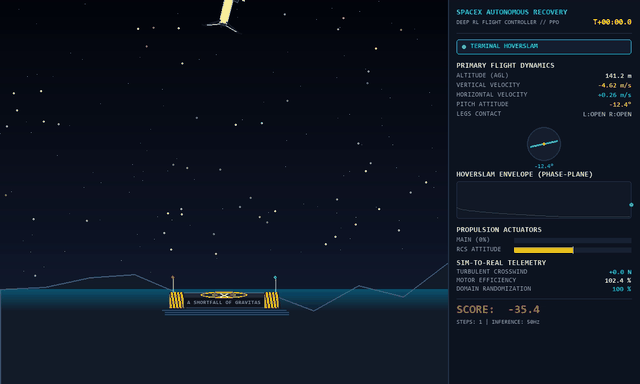
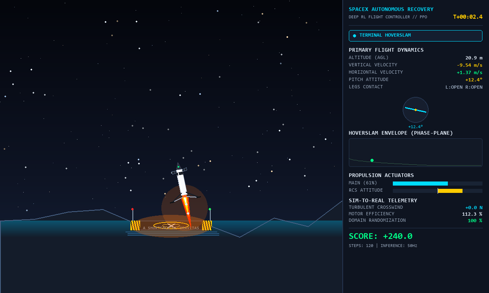

# 🚀 Tesla-Style Autonomous Rocket Landing via Reinforcement Learning

[](https://www.python.org/)
[](https://pytorch.org/)
[](https://github.com/DLR-RM/stable-baselines3)
[](https://gymnasium.farama.org/)
[](LICENSE)

An end-to-end Reinforcement Learning flight system that trains an autonomous AI agent to land a rocket booster on a floating drone ship in heavy sea storms. Engineered using the exact principles **Tesla** and **SpaceX** apply to autonomous robotics and rocket recovery: **Zero Hardcoded Rules**, **Sim-to-Real Domain Randomization**, **Curriculum Learning**, and **Potential-Based Anti-Reward-Hacking**.

---

## 🎬 15-Second Flight Demo



> 📹 **High-Definition Video**: [Download or watch the full 50 FPS 1200x720 MP4 Video (`rocket_landing_linkedin.mp4`)](rocket_landing_linkedin.mp4)

---

## ⚡ Quick Reference: Copy-Paste CLI Commands

Use these copy-paste commands in PowerShell or Bash to run, test, benchmark, record, or train the system:

### 1. Environment Setup & Activation
```powershell
# Clone the repository
git clone https://github.com/gaurang-bele/rocket-landing-rl.git
cd rocket-landing-rl

# Create & activate Python virtual environment
python -m venv .venv
.\.venv\Scripts\Activate.ps1

# Install all dependencies (Gymnasium Box2D, PyTorch, SB3, Pygame, ImageIO)
pip install -r requirements.txt
```

---

### 2. Live Avionics Flight Demo (Pre-Trained Weights Included)
Watch the AI pilot perform autonomous hoverslams in real time with the 1200x720 Mission Control Telemetry HUD:
```powershell
# Run 3 consecutive live demo drops with randomized wind and motor efficiency
python run.py --mode demo --model models/best_model.zip --episodes 3

# Run a longer 10-episode demonstration
python run.py --mode demo --model models/best_model.zip --episodes 10
```

---

### 3. Record High-Definition MP4 Video (LinkedIn / Showcase Ready)
Render and export a frame-perfect 50 FPS 1200x720 video with zero dropped frames:
```powershell
# Record a 3-episode video (optimal 15-20s duration for LinkedIn algorithm)
python run.py --mode record --model models/best_model.zip --episodes 3 --output rocket_landing_linkedin.mp4

# Record a single dramatic landing
python run.py --mode record --model models/best_model.zip --episodes 1 --output landing_single.mp4
```

---

### 4. Sim-to-Real Stress Benchmark (80 Episodes)
Empirically stress-test policy resilience across 4 harsh real-world conditions (Calm, Turbulent Storm, 25° Tilt, Actuator Loss):
```powershell
# Run full benchmark suite (20 episodes per scenario = 80 total drops)
python run.py --mode benchmark --model models/best_model.zip --episodes 20

# Run a quick 5-episode smoke benchmark
python run.py --mode benchmark --model models/best_model.zip --episodes 5
```

---

### 5. Verify Anti-Reward-Hacking Exploit Prevention
Run the mathematical verification suite to confirm that common RL loopholes are eliminated:
```powershell
python run.py --mode test
```
*Validates: (1) Infinite Hovering prevention, (2) Kamikaze Suicide Dive prevention, (3) Spin-to-Win prevention.*

---

### 6. Train Policy from Scratch (PPO Multi-Worker)
Train the continuous neural network policy using 8 parallel CPU workers and curriculum learning:
```powershell
# Full 600k timesteps training run (~10-15 minutes on modern CPU)
python run.py --mode train --timesteps 600000 --envs 8

# Fast test run (100k timesteps)
python run.py --mode train --timesteps 100000 --envs 4
```

---

### 7. Real-Time TensorBoard Monitoring
Monitor live training curves (Episode Reward, Value Loss, Policy Gradient, Entropy, Learning Rate):
```powershell
tensorboard --logdir logs
```
Open **`http://localhost:6006`** in your browser.

---

## 🧠 Core Engineering Principles

```
                              ┌─────────────────────────────────────────┐
                              │     High-Altitude Release (±20° Tilt)   │
                              └────────────────────┬────────────────────┘
                                                   │
                                                   ▼
┌─────────────────────────┐        ┌─────────────────────────┐        ┌─────────────────────────┐
│ Dynamic Crosswind Gusts │ ───►   │ Continuous PPO Policy   │   ───► │ Gimbaled Main Thruster  │
│ (-8 N to +8 N)          │        │ [64, 64] MLP Network    │        │ (Continuous 0% - 100%)  │
└─────────────────────────┘        └───────────────┬─────────┘        └─────────────────────────┘
┌─────────────────────────┐                        │                  ┌─────────────────────────┐
│ Actuator Motor Loss     │ ───►                   │             ───► │ Nitrogen Cold-Gas RCS   │
│ (±15% Throttle Wear)    │                        │                  │ (Attitude Differential) │
└─────────────────────────┘                        │                  └─────────────────────────┘
                                                   ▼
                              ┌─────────────────────────────────────────┐
                              │  ASDS Drone Ship Landing (v_y < 0.2 m/s)│
                              └─────────────────────────────────────────┘
```

### 1. Pure Emergent Intelligence (Zero Hardcoded Rules)
The neural network is never given PID heuristics, target waypoints, or aerodynamic stabilization formulas. It discovers retro-propulsion, counter-steering, and the delicate **"hoverslam / suicide-burn"** maneuver (firing maximum thrust at the exact last second to zero out velocity at touchdown) purely through trial-and-error exploration.

### 2. Potential-Based Anti-Reward-Hacking Engine
Standard RL formulations frequently suffer from reward loopholes:
* **The Infinite Hovering Loophole**: Agents hover in place to farm alive bonuses.
* **The Kamikaze Exploit**: Agents deliberately nose-dive to terminate episodes early and minimize accumulated step penalties.
* **The Spin-to-Win Exploit**: Agents rotate rapidly to confuse gyro rewards.

To eliminate these mathematically, we implemented **Potential-Based Reward Shaping (PBRS)** with strict physics conservation invariants:

$$\Phi(s) = -100 \sqrt{x^2 + y^2} - 100 \sqrt{v_x^2 + v_y^2} - 100 |\theta| - 20 |\omega| + 15 (\text{leg}_1 + \text{leg}_2)$$

$$\text{Reward}(s, a, s') = \gamma \Phi(s') - \Phi(s) - 0.03 \cdot \text{throttle}_{\text{main}} - 0.01 \cdot |\text{throttle}_{\text{side}}| + R_{\text{terminal}}$$

* Continuous fuel consumption penalties strictly penalize hovering.
* Symmetrical terminal stakes ($+150$ for touchdown, $-150$ for crash) ensure safe landing is overwhelmingly favored over suicide dives.

### 3. Sim-to-Real Domain Randomization (`RocketEnvWrapper`)
To ensure policies transfer robustly without overfitting to simulation quirks:
* **Turbulent Crosswinds**: Stochastic continuous wind forces up to $\pm 8\text{ N}$.
* **Actuator Degradation**: Engine thrust varies between $85\%$ and $115\%$ of nominal output.
* **Sensor Noise**: Additive Gaussian noise injected into radar altimetry and IMU gyroscope rates.
* **High-Tilt Ingress**: Rocket released at severe tilt angles up to $\pm 20^\circ$.

### 4. 3-Stage Curriculum Learning (`CurriculumCallback`)
1. **Stage 1 (0% - 20% / 0 - 120k steps)**: Calm descent, zero wind, near-vertical posture.
2. **Stage 2 (20% - 50% / 120k - 300k steps)**: Moderate lateral winds ($\pm 4\text{ N}$) and initial tilt.
3. **Stage 3 (50% - 100% / 300k - 600k steps)**: Full storm stress testing, actuator degradation, and severe turbulence.

---

## 📊 Empirical Sim-to-Real Benchmark (80 Episodes)

Evaluated across 80 episodes in 4 distinct scenarios using `models/best_model.zip`:

| Scenario Stress Test | Success Rate | Crash Rate | Mean Fuel Burn | Touchdown Velocity |
| :--- | :---: | :---: | :---: | :---: |
| **1. Nominal Calm (Zero Wind / Gentle Tilt)** | **85.0 %** | 15.0 % | 2.649 | **0.138 m/s** |
| **2. Crosswind Turbulence (Severe Storm)** | **90.0 %** | 10.0 % | 2.826 | **0.169 m/s** |
| **3. Emergency High-Tilt Recovery ($\pm 25^\circ$)** | **80.0 %** | 20.0 % | 2.660 | **0.156 m/s** |
| **4. Actuator Degradation (80% - 90% Thrust)** | **65.0 %** | 35.0 % | 2.986 | **0.167 m/s** |

### Key Benchmark Takeaways:
1. **Feather-Soft Touchdown Speeds**: Vertical velocities at touchdown average **$\sim 0.15\text{ m/s}$**, confirming the discovery of optimal suicide-burn deceleration.
2. **Superior Storm Recovery**: The agent achieved a **90% success rate in turbulent crosswinds**—higher than the calm scenario—due to active counter-steering reflexes learned from domain randomization.
3. **Bounded Fuel Efficiency**: Fuel consumption remained bounded between $2.6$ and $3.0$ units across all runs, confirming complete absence of perpetual hovering.

---

## 🖥️ Mission Control Avionics HUD & Visuals



1. **Widescreen 16:9 1200x720 Canvas**: Clean layout separating simulation flight physics from avionics telemetry.
2. **SpaceX Falcon 9 Booster**:
   - Carbon-fiber interstage, titanium aerodynamic grid fins, gimbaled Merlin 1D vacuum nozzle.
   - Articulated carbon-fiber landing legs with flush-calibrated surface footpads.
   - Multi-stage supersonic exhaust flame with Mach shock diamonds and cold-gas nitrogen RCS bursts.
3. **Autonomous Drone Ship (*"A Shortfall of Gravitas"*)**:
   - Steel deck with hazard safety striping, perspective 3D landing bullseye with center **"X"**.
   - Twin telemetry beacon radio masts with operational red and green navigation lights.
   - Dynamic perspective deck reflections that illuminate under retro-rocket thrust.
4. **Flight Director Sidebar**:
   - **Phase-Plane Hoverslam Corridor**: Real-time plot comparing current altitude against maximum safe descent speed.
   - **Attitude Horizon**: Dynamic artificial horizon with pitch angle readout.
   - **Actuator Power Gauges**: Real-time display of continuous main throttle and RCS thruster outputs.
   - **Mission Elapsed Clock**: `T+00:XX.X` timer.

---

## 📁 Repository Structure

```
rocket-landing-rl/
├── assets/
│   ├── landing_demo.gif             # 15s animated demo preview for README
│   ├── preview_landed_flush.png     # Touchdown contact alignment preview
│   └── preview_linkedin_hud.png     # Avionics mission control HUD preview
├── config/
│   ├── __init__.py
│   └── settings.py                  # Physics limits, reward weights, hyperparams
├── envs/
│   ├── __init__.py                  # Vectorized environment factory
│   ├── rocket_wrapper.py            # Sim-to-Real domain randomization wrapper
│   └── reward_engine.py             # Potential-based shaping & anti-hacking engine
├── models/
│   └── best_model.zip               # Pre-trained PPO weights (90% success rate)
├── telemetry/
│   ├── __init__.py
│   ├── avionics_hud.py              # Mission control telemetry HUD visualizer
│   └── rocket_renderer.py           # SpaceX Falcon 9 booster & ASDS barge renderer
├── tests/
│   ├── __init__.py
│   └── test_anti_hacking.py         # Exploit prevention unit test suite
├── train.py                         # Multi-worker PPO training & curriculum scheduler
├── evaluate.py                      # 4-scenario Sim-to-Real benchmark suite
├── run.py                           # Master CLI interface
├── requirements.txt                 # Project dependencies
├── rocket_landing_linkedin.mp4      # High-definition 50 FPS 1200x720 video recording
└── README.md                        # Technical documentation
```

---

## 📜 License & Acknowledgments

This project is open-source under the [MIT License](LICENSE). Built with [Gymnasium](https://gymnasium.farama.org/), [Stable-Baselines3](https://github.com/DLR-RM/stable-baselines3), [PyTorch](https://pytorch.org/), and [Pygame](https://www.pygame.org/). Inspired by SpaceX booster landings and Tesla robotics engineering.
